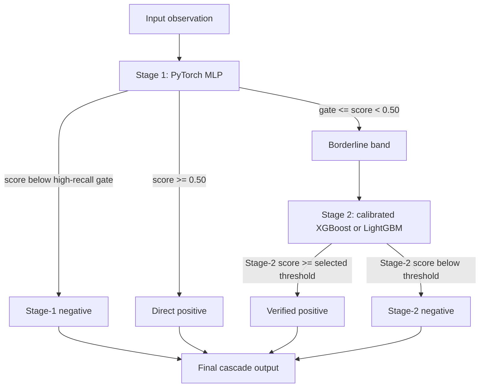
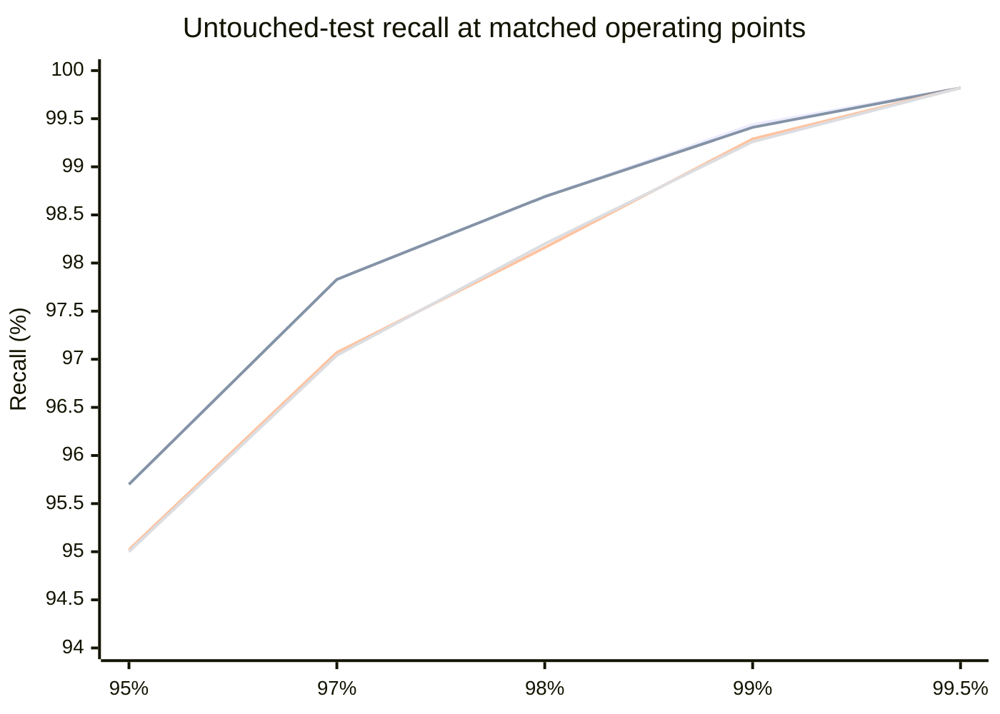
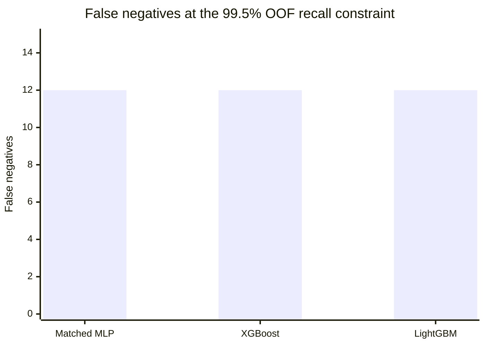
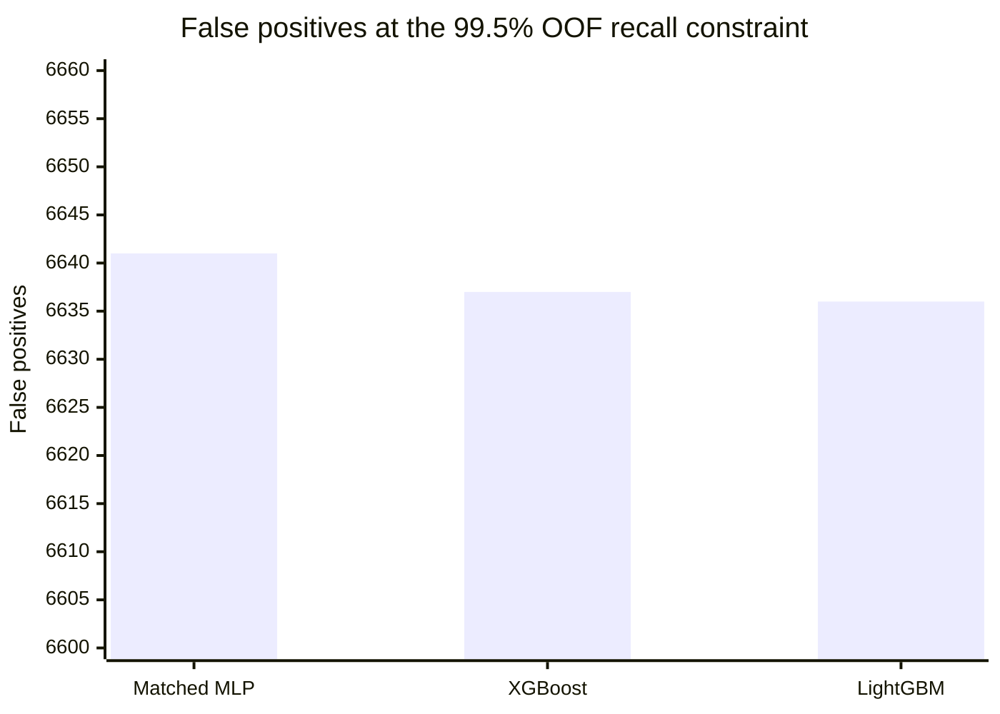

# CardioRisk AI — High-Recall Cardiovascular Dataset Research

A modular machine-learning research project with a Streamlit interface. The deployed inference path uses a **PyTorch multilayer perceptron (MLP)**. A separate, leakage-aware experiment evaluates a two-tier architecture in which a high-recall MLP screens observations and a calibrated tree model (XGBoost or LightGBM) selectively verifies borderline cases.

> **Research and education only.** This project is not clinically validated and must not be used for diagnosis, screening, treatment, triage, or healthcare decisions. A negative model output does not rule out cardiovascular disease. Anyone with health concerns should seek qualified medical advice. The dataset is cross-sectional: its label is not a prediction of future disease.

## Project goals and error-cost philosophy

The project treats a false negative (an actual positive row predicted negative) as more costly than a false positive (an actual negative row predicted positive). The modelling workflow therefore emphasizes sensitivity/recall, reports false-negative counts explicitly, and compares operating points at stringent recall constraints. The deployed MLP selects the maximum-recall development OOF threshold subject to a 50% precision guardrail; this is a transparent modelling guardrail, not a medical cost ratio.

This is an experimental design preference, not a clinically established cost ratio. No numeric clinical harm/cost ratio is assumed. Precision and specificity are still reported, but a gain in either is not considered a success if it causes an unacceptable increase in false negatives.

## What is deployed versus experimental

| Component | Role | Used by live Streamlit prediction form? |
|---|---|---|
| PyTorch MLP (128–64–32) | Primary high-recall classifier | **Yes** |
| XGBoost Stage 2 | Selective verification candidate | No — research only |
| LightGBM Stage 2 | Selective verification candidate | No — research only |

The deployed MLP and its saved preprocessing/model artifacts remain the production-style demonstration. The two-tier experiment is presented in the Streamlit **Two-tier study** tab for transparent comparison; it does not silently replace the deployed inference path.

## Architecture: two-tier selective verification

### Routing diagram



### Stage 1 — high-recall screen

1. The original MLP is trained using the project’s cross-validation pipeline.
2. Out-of-fold (OOF) development predictions are generated so each development row is scored by a model that did not train on that row.
3. A Stage-1 gate is selected from development OOF predictions to target **99.5% recall**.
4. The final MLP is refitted on the development partition and scores the untouched test partition.

The current experiment selected a gate of **0.145333** with **99.5026% development OOF recall**. This is a research operating point, not a clinical threshold.

### Stage 2 — selective verification

Only observations with Stage-1 scores in the interval **[gate, 0.50)** are sent to Stage 2. Scores at or above 0.50 bypass Stage 2 as direct positives. Scores below the gate do not reach Stage 2 and therefore cannot be recovered by it.

Two calibrated tree models are compared:

- **XGBoost**
- **LightGBM**

Each model is trained only on the Stage-1 borderline development population. Five outer stratified folds produce Stage-2 OOF scores; sigmoid calibration is fitted inside each outer training fold. The Stage-2 decision threshold is selected from development OOF data, never from the untouched test set.

### Final decision rule

```text
positive =
    (stage1_score >= 0.50)
    OR
    (gate <= stage1_score < 0.50 AND stage2_score >= stage2_threshold)
```

The Stage-2 score is a calibrated model score intended to estimate the positive-class probability under the calibration procedure. It is **not** the literal precision of an individual prediction, a guarantee, or a clinically validated probability.

### Leakage controls

- Split development and test data before cross-validation.
- Fit preprocessing inside each training fold.
- Use OOF Stage-1 predictions to define Stage-2 development eligibility.
- Train Stage 2 only on OOF-routed development rows.
- Select Stage-2 thresholds on development OOF predictions only.
- Evaluate each frozen cascade once on the same untouched test rows as the matched MLP reference.
- Use paired bootstrap resampling for test-set metric differences. The intervals are conditional on the fitted models and frozen thresholds; they do not include all model-training or selection uncertainty.

## Latest two-tier experiment

The latest successful GitHub Actions run evaluated **13,716 untouched test rows** and compared five development OOF end-to-end recall constraints: 95%, 97%, 98%, 99%, and 99.5%.

### High-recall comparison: 99% and 99.5%

The MLP reference threshold is selected on development OOF predictions to match the cascade’s OOF recall. It is therefore a matched-operating-point reference, not necessarily the default threshold currently used by the deployed Streamlit MLP.

| OOF recall constraint | Model | Test recall | Test precision | Specificity | False positives | False negatives |
|---:|---|---:|---:|---:|---:|---:|
| 99% | Matched MLP | 99.44% | 51.32% | 7.62% | 6,402 | 38 |
| 99% | XGBoost cascade | 99.29% | 51.85% | 9.70% | 6,258 | 48 |
| 99% | LightGBM cascade | 99.26% | 52.00% | 10.27% | 6,218 | 50 |
| 99.5% | Matched MLP | 99.82% | 50.50% | 4.17% | 6,641 | 12 |
| 99.5% | XGBoost cascade | 99.82% | 50.51% | 4.23% | 6,637 | 12 |
| 99.5% | LightGBM cascade | 99.82% | 50.51% | 4.24% | 6,636 | 12 |

**Interpretation under a false-negative-first policy**

- At the 99% target, XGBoost adds **8 false negatives** and LightGBM adds **12 false negatives** compared with their matched MLP references. They reduce false positives, but this is the wrong trade-off when missed positives are the dominant concern.
- At the 99.5% target, both cascades match the MLP reference’s **12 false negatives**. LightGBM removes **5 false positives** (6,636 versus 6,641); XGBoost removes 4.
- The 99.5% result is the most defensible research operating point for the stated preference, but the improvement is very small. It does **not** justify replacing the deployed MLP.
- At lower recall constraints, the cascades also tend to improve precision/specificity while sacrificing test recall. Read the false-negative column before considering any apparent precision gain.

### Recall profile across all five operating points



Series order: matched MLP reference (LightGBM-matched), matched MLP reference (XGBoost-matched), XGBoost cascade, LightGBM cascade.

### Error-count comparison at 99.5%





The charts summarize one fixed test evaluation. They are not confidence intervals or evidence of clinical effectiveness.

## Deployed MLP test snapshot

The current deployed MLP high-recall operating point has the following held-out test results:

| Metric | Value |
|---|---:|
| Recall | 97.44% |
| Precision | 54.65% |
| Specificity | 20.82% |
| F1 | 0.7002 |
| ROC-AUC | 0.8025 |
| PR-AUC | 0.7804 |
| Brier score | 0.1824 |
| Threshold | 0.237512 |

Confusion matrix (rows = actual class, columns = predicted class):

| | Predicted 0 | Predicted 1 |
|---|---:|---:|
| Actual 0 | 1,443 | 5,487 |
| Actual 1 | 174 | 6,612 |

This illustrates the trade-off: the high-recall threshold captures most positive labels but produces many false positives. It is a model operating point on this dataset, not a clinically approved threshold.

## Streamlit interface

The Streamlit app includes:

- Main-page input form for dataset-style observations.
- MLP inference and a clearly labelled model score (not a clinical probability).
- Integrated Gradients feature-contribution explanation, when the explanation background is available.
- Model performance overview and confusion matrix.
- Threshold exploration, calibration diagnostics and subgroup summaries.
- Cross-validated model benchmarks and specificity/boosting research.
- **Two-tier study tab** with a routing explanation, interactive recall-constraint selector, test metrics, precision/recall/specificity charts, and false-positive/false-negative comparisons.

The live input form calls the **MLP only**. Stage 2 is not active in the live prediction path.

## Dataset and limitations

The project uses a cross-sectional cardiovascular dataset with demographic, body-measurement, blood-pressure, lifestyle and categorical health-indicator fields. Cleaning removes invalid target values and implausible measurement ranges; engineered features include BMI, pulse pressure and mean arterial pressure.

### Input schema and preprocessing

| Raw field | Meaning | Handling |
|---|---|---|
| `age` | Age in days in the source file | Converted to years using 365.25 days |
| `gender` | Dataset gender code | One-hot encoded |
| `height`, `weight` | cm and kg | Used to derive BMI |
| `ap_hi`, `ap_lo` | Systolic and diastolic pressure | Used to derive pulse pressure and mean arterial pressure |
| `cholesterol`, `gluc` | Ordinal dataset categories | One-hot encoded |
| `smoke`, `alco`, `active` | Binary lifestyle indicators | Imputed and retained as binary features |
| `cardio` | Cross-sectional target label (0/1) | Prediction target; not a future event |

The cleaning pipeline keeps rows with a valid binary target, systolic pressure 70–250, diastolic pressure 40–180, systolic greater than diastolic, height 120–220 cm, weight 35–200 kg, and BMI 12–60. These are dataset quality filters, not clinical reference ranges. The identifier is retained in the Stage-1 audit ledger but excluded from model features. All learned imputers, scalers and encoders are fitted within each training fold.

Important limitations:

- Cross-sectional association is not future-event prediction.
- Dataset labels may contain measurement, selection and labelling bias.
- No external-site or temporal validation is reported.
- The dataset does not establish a representative clinical population.
- Calibration and subgroup summaries are exploratory, not clinical calibration or fairness certification.
- The model has not undergone prospective evaluation, clinical validation, or regulatory review.
- A negative output must never be used to rule out disease or delay care.

## Repository artifacts

| Artifact | Purpose |
|---|---|
| `artifacts/mlp_state_dict.pt` | Deployed MLP weights |
| `artifacts/preprocessing.json` | Saved feature preprocessing schema |
| `artifacts/metrics.json` | MLP evaluation and operating points |
| `artifacts/mlp_oof_predictions.csv` | Development OOF MLP scores |
| `artifacts/tree_stage2_cascade_comparison.json` | Full XGBoost/LightGBM comparison, paired bootstrap results and thresholds |
| `artifacts/tree_stage2_cascade_comparison.csv` | Tabular two-tier results |
| `artifacts/tree_stage2_cascade_folds.csv` | Stage-2 outer-fold row counts |
| `artifacts/stage1_prediction_dataset.csv` | Stage-1 prediction/routing ledger, original features, target and split |
| `artifacts/mlp_matched_recall_audit.*` | Earlier matched-recall MLP cascade audit |

Only development OOF borderline rows are marked Stage-2 training eligible in the prediction ledger. The untouched test rows are for evaluation only.

## Run locally

Python 3.11 is used in the GitHub Actions workflow.

```bash
git clone https://github.com/Harshithpatali/cardiorisk-ai.git
cd cardiorisk-ai
pip install -r requirements.txt
python validate_data.py
python train.py
python tree_stage2_cascade.py
pytest -q
streamlit run app.py
```

The training and cascade scripts write their research outputs under `artifacts/`. The repository workflow runs compilation, data validation, model training, cross-validation studies, cascade comparisons, tests and artifact validation.

## Quality checks and workflow

Latest completed workflow: [GitHub Actions run #89](https://github.com/Harshithpatali/cardiorisk-ai/actions/runs/44881293843).

The workflow validates that both tree candidates contain all five recall targets (95%, 97%, 98%, 99%, 99.5%), checks that the Stage-1 prediction ledger exists, and runs the automated test suite. The cascade prediction function also validates that direct-positive masks, routed masks and full-length Stage-2 scores are aligned and disjoint.

## Project status

- **Deployed inference:** PyTorch MLP.
- **Research candidate:** LightGBM selective Stage 2, marginally ahead of XGBoost in the current test comparison.
- **Promotion decision:** Not promoted. At 99.5% recall it matches MLP false negatives but saves only five false positives; at 99% it adds false negatives.
- **Next scientific requirement before any promotion:** independent external/temporal validation and a pre-specified, defensible false-negative cost policy. No test-set retuning.

