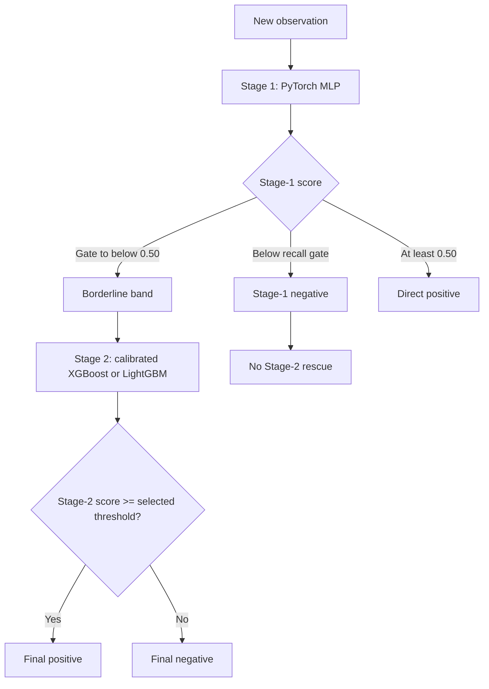
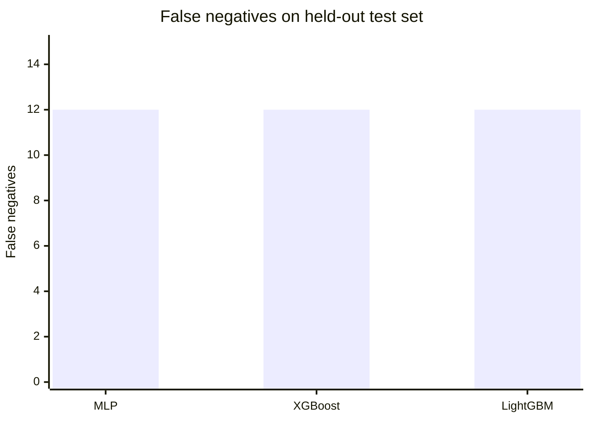
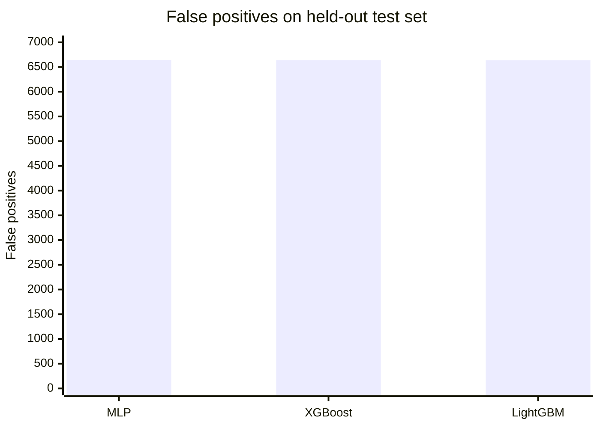

# CardioRisk AI — Recall-first cardiovascular dataset research

A research application for studying cardiovascular-dataset classification with a PyTorch multilayer perceptron (MLP), plus an experimental two-tier verification cascade using XGBoost and LightGBM.

> **Research and education only.** This project is not a medical device and is not clinically validated. It must not be used for diagnosis, screening, treatment, triage, or healthcare decisions. The source dataset is cross-sectional: its label describes the dataset observation, not a future cardiovascular event or an individual's future disease risk. A negative model output does not rule out disease.

## Project goals

The main design preference is to avoid false negatives (actual positive observations classified as negative), because the project treats that error as more costly than a false positive. This is an experimental cost preference, not a clinical recommendation.

The project therefore:
- Trains a high-recall Stage-1 PyTorch MLP.
- Selects thresholds from development out-of-fold (OOF) predictions, never from the held-out test set.
- Compares XGBoost and LightGBM as selective Stage-2 verifiers for borderline Stage-1 positives.
- Reports false negatives and false positives explicitly, rather than optimizing accuracy alone.
- Keeps the deployed Streamlit single-observation inference path on the existing PyTorch MLP. The tree cascade is a research comparison and is not silently promoted into production.

## Two-tier model architecture

### Routing diagram



### Stage 1 — high-recall screening

The Stage-1 model is the existing PyTorch MLP (128–64–32). A gate threshold is selected from development OOF predictions to meet a 99.5% OOF recall target.

- Score below the gate: classified negative by Stage 1.
- Score from the gate up to, but not including, 0.50: sent to Stage 2.
- Score at least 0.50: classified positive directly, bypassing Stage 2.

The current saved experiment selected a gate of **0.145333**, achieving **99.5026% development OOF recall**. The corresponding Stage-1 gate recall on the held-out test partition is reported in the experiment artifact.

**Important limitation:** observations below the Stage-1 gate cannot be recovered by Stage 2. If Stage 1 misses an actual positive, the second model never sees it. This is why gate recall and end-to-end false-negative counts are first-class measures.

### Stage 2 — selective precision-oriented verification

Only the borderline development observations are used to train Stage 2. XGBoost and LightGBM are evaluated separately.

- Stage-2 training rows come only from Stage-1 OOF borderline predictions on the development partition.
- The Stage-2 pipeline fits preprocessing within each fold.
- Five outer stratified folds produce OOF Stage-2 scores.
- Sigmoid calibration is fitted inside each outer training fold.
- Thresholds are selected from development OOF results under end-to-end recall constraints.
- The held-out test set is evaluated after training and threshold selection; it is not used to fit the models or choose thresholds.

A Stage-2 score is a model-estimated positive-class probability after sigmoid calibration. It is **not** the literal precision for one person, a guarantee, or a clinically validated probability. Precision is a population-level property of predictions at a selected threshold.

The final cascade rule is:

```text
positive =
    (stage1_score >= 0.50)
    OR (
        stage1_gate <= stage1_score < 0.50
        AND stage2_score >= selected_stage2_threshold
    )
```

## Current experiment results

The current committed comparison artifact contains **13,716 untouched test observations**. The following table shows the **99.5% development OOF recall-constraint** comparison. The baseline is a single MLP threshold selected to match the cascade's development OOF recall.

| Held-out test metric | Single-stage MLP | XGBoost cascade | LightGBM cascade |
|---|---:|---:|---:|
| Recall | 99.8232% | 99.8232% | 99.8232% |
| Precision | 50.4957% | 50.5108% | 50.5145% |
| Specificity | 4.1703% | 4.2280% | 4.2424% |
| False positives | 6,641 | 6,637 | 6,636 |
| False negatives | 12 | 12 | 12 |

At this operating point, LightGBM matches the MLP's false-negative count and reduces false positives by **5** on this test set. That is a very small gain; it does not justify replacing the deployed MLP.

### What happens at the 99% development recall constraint?

| Held-out test metric | Single-stage MLP | XGBoost cascade | LightGBM cascade |
|---|---:|---:|---:|
| Recall | 99.4400% | 99.2927% | 99.2632% |
| Precision | 51.3156% | 51.8467% | 51.9994% |
| Specificity | 7.6190% | 9.6970% | 10.2742% |
| False positives | 6,402 | 6,258 | 6,218 |
| False negatives | 38 | 48 | 50 |

At 99%, the tree cascades reduce false positives but increase false negatives. Under this project's false-negative-first preference, this is an unfavorable trade-off. Higher precision alone is not enough to select a model.

### Error trade-off chart (99.5% target)





These results are descriptive for this dataset and split. They are not evidence of clinical performance or generalization to other populations.

## Streamlit user interface

The app contains:
- **Two-tier study:** routing explanation, recall-target selector, held-out comparison charts, and explicit false-negative / false-positive trade-offs.
- **Overview:** held-out MLP metrics, confusion matrix, and cross-validation results.
- **Threshold lab:** recall-constrained operating-point exploration.
- **Calibration, subgroups, benchmark, specificity, and boosting tabs:** research diagnostics with limitations shown in the interface.
- **Observation form:** enter a dataset-style observation and inspect the deployed PyTorch MLP score and Integrated Gradients feature contributions.

The current observation form intentionally calls **only the deployed PyTorch MLP**. The experimental XGBoost/LightGBM cascade is displayed in the research dashboard but is not wired into the live prediction form. This avoids presenting a research model as a validated or deployed medical classifier.

## How to test a new observation in the UI

1. Open the deployed Streamlit app.
2. Scroll to **Explore an observation**.
3. Enter age, gender, height, weight, systolic/diastolic pressure, cholesterol, glucose, smoking, alcohol, and physical activity.
4. Click **Run cardiovascular data analysis**.
5. Review the Stage-1 MLP score, the selected MLP threshold, and the Integrated Gradients explanation.
6. Change one or more input values and submit again to compare how the model output changes. Use plausible values within the displayed input ranges; systolic pressure must be greater than diastolic pressure.

To inspect the experimental two-tier results, open the **Two-tier study** tab and change the **Development OOF end-to-end recall constraint** selector. This changes which precomputed test comparison is displayed; it does not retrain the models or change the live prediction form.

For a repeatable local smoke test:

```bash
pip install -r requirements.txt
pytest -q
streamlit run app.py
```

Use the app's example/default values only as a software test, not as a personal health assessment. The displayed score is not a clinical probability, and a negative result must never be used to delay medical advice.

## Leakage-aware training and evaluation

1. Validate and clean the source data using deterministic row rules.
2. Split development and held-out test data with stratification.
3. Fit preprocessing only on each training fold.
4. Generate Stage-1 development OOF probabilities.
5. Select the Stage-1 recall gate from OOF predictions.
6. Train Stage 2 only on the Stage-1 OOF borderline subset of development data.
7. Produce Stage-2 OOF scores using outer folds and fold-local calibration.
8. Select Stage-2 thresholds using development OOF data only.
9. Evaluate the final cascade and matched MLP baseline on the untouched test partition.
10. Report recall, precision, specificity, F1, false positives, false negatives, calibration diagnostics, and paired bootstrap comparisons.

The paired bootstrap intervals are conditional on the fitted models and selected thresholds. They do not include model-training or threshold-selection uncertainty. An independent external dataset and prospective validation would be needed before any clinical claims could be considered.

## Artifacts

Key generated outputs under `artifacts/`:

| Artifact | Purpose |
|---|---|
| `metrics.json` | Deployed MLP configuration and held-out metrics |
| `mlp_state_dict.pt` | Deployed PyTorch model weights |
| `preprocessing.json` | Saved Stage-1 preprocessing schema |
| `mlp_oof_predictions.csv` | Development OOF Stage-1 predictions |
| `tree_stage2_cascade_comparison.json/.csv` | XGBoost / LightGBM cascade comparison |
| `tree_stage2_cascade_folds.csv` | Stage-2 outer-fold diagnostics |
| `stage1_prediction_dataset.csv` | Row-level Stage-1 predictions, split, routing, and Stage-2 eligibility |
| `mlp_matched_recall_audit.*` | Earlier matched-recall MLP cascade audit |

## Repository structure

- `app.py` — Streamlit research interface and deployed MLP inference.
- `train.py` — baseline MLP training orchestration.
- `tree_stage2_cascade.py` — research-only selective XGBoost / LightGBM cascade.
- `model.py`, `model_training.py` — model definition and training helpers.
- `preprocessing.py`, `data_split.py` — data preparation and split utilities.
- `evaluation.py`, `explainability.py` — metrics and local explanations.
- `tests/` — unit tests and routing invariants.
- `.github/workflows/train-mlp.yml` — reproducible training, evaluation, artifact validation, and artifact publication.

## Run locally

```bash
git clone https://github.com/Harshithpatali/cardiorisk-ai.git
cd cardiorisk-ai
python -m venv .venv
# Activate the virtual environment for your OS.
pip install -r requirements.txt
python validate_data.py
python train.py
python tree_stage2_cascade.py
pytest -q
streamlit run app.py
```

Training requires the source dataset in the repository's expected data location. The Streamlit app requires the committed model and preprocessing artifacts.

## Limitations

- Cross-sectional labels are not future outcomes.
- No clinical validation, external validation, prospective evaluation, or clinical utility analysis has been performed.
- Dataset sampling and label construction may introduce bias and distribution shift.
- High recall on one held-out split does not guarantee high recall in a new population.
- Calibration on a research dataset does not establish clinical probability accuracy.
- Integrated Gradients attributes model behavior; it does not establish causation.
- The cascade cannot rescue Stage-1 false negatives below the gate.
- The tree cascade remains research-only; the deployed Streamlit form uses the PyTorch MLP.
