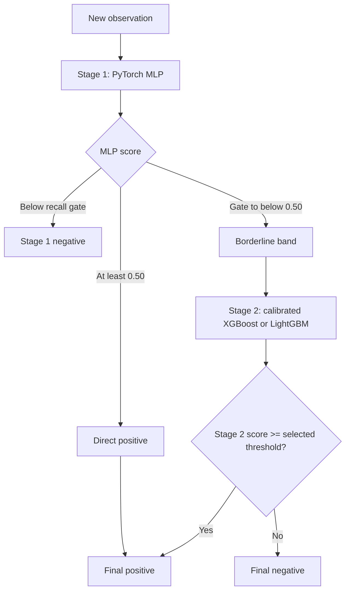

# CardioRisk AI — Recall-first cardiovascular classification research

A Streamlit research application for exploring cardiovascular dataset patterns with a PyTorch multilayer perceptron (MLP), statistical evaluation, explainability, and an experimental two-tier verification cascade.

> **Research and education only.** This project is not clinically validated and must not be used for diagnosis, treatment, screening, triage, or healthcare decisions. The source dataset is cross-sectional: the target is a recorded class label, not a future disease event or an individual's future cardiovascular risk. A negative output does not rule out disease or justify delaying professional care.

## Project goals

The design gives more weight to avoiding false negatives (actual positive observations classified negative) than to avoiding false positives. The research therefore reports recall and false-negative counts alongside precision, specificity, false positives, calibration, and discrimination. No model is promoted just because its precision improves.

## Current application

- **Live individual-observation inference:** the deployed PyTorch MLP (128–64–32) only.
- **Research comparison:** a high-recall MLP screening gate followed by calibrated XGBoost or LightGBM for borderline observations.
- **Explainability:** Integrated Gradients for the live MLP output, with completeness diagnostics.
- **Evaluation:** stratified holdout, fold-based validation, out-of-fold (OOF) development predictions, threshold analysis, calibration diagnostics, subgroup summaries, and paired comparisons.
- **Deployment:** the research cascade does not replace or change the existing MLP inference path. Render and Streamlit deployment configuration are not changed by the cascade experiment.

## Two-tier model: how it works

The purpose of the second tier is to verify uncertain positive-looking observations, not to screen the entire population again.



### Routing policy

1. **Stage 1 — high-recall screen.** The existing MLP produces a positive-class score. Its gate is selected from development OOF predictions to meet a 99.5% recall target. In the current experiment the selected gate is approximately **0.1453**, with **99.50% development OOF recall**.
2. **Below the gate.** The row is classified negative by the cascade. Stage 2 does not see it and cannot recover a missed positive. This is the most important structural limitation when false negatives are costly.
3. **Borderline band.** Scores from the gate up to (but not including) 0.50 are sent to Stage 2. The experiment routed **24,960 development rows** into this band.
4. **Direct positive.** Scores at or above 0.50 bypass Stage 2 and remain positive.
5. **Stage 2 — selective verification.** XGBoost and LightGBM are evaluated separately. They are trained only on borderline development rows with OOF Stage-1 predictions. A sigmoid calibrator is fitted within each outer training fold.
6. **Final decision.** A borderline observation is positive only if its Stage-2 score meets the threshold selected using development OOF predictions. Direct Stage-1 positives remain positive.

The Stage-2 score is a model-estimated positive-class probability after calibration. It is **not** the literal precision for that individual. Precision is a population-level metric measured across observations at a decision threshold.

### Leakage controls

- The stratified development/test split is made before model selection.
- Stage-1 development routing uses OOF MLP predictions, not in-sample fitted predictions.
- Preprocessing is fitted within each Stage-2 fold.
- Stage-2 models and sigmoid calibrators are fitted only on the corresponding training fold.
- Stage-2 thresholds are selected from development OOF predictions only.
- The untouched test partition is used for the final comparison, not threshold tuning.
- The test set contains **13,716 rows** in the current published run.
- The comparison is research-only. The test-set results are not a substitute for independent external validation.

## Two-tier experiment: current held-out results

The table below shows the LightGBM cascade against a single-stage MLP baseline matched to the same development OOF recall constraint. Counts are measured on the same 13,716 held-out test rows. The development target is not a guarantee that the test recall will equal it.

| Development OOF recall constraint | Model | Test recall | Test precision | Specificity | False positives | False negatives |
|---:|---|---:|---:|---:|---:|---:|
| 99.0% | Matched MLP | 99.44% | 51.32% | 7.62% | 6,402 | 38 |
| 99.0% | LightGBM cascade | 99.26% | 52.00% | 10.27% | 6,218 | 50 |
| 99.5% | Matched MLP | 99.82% | 4? | 4.17% | 6,641 | 12 |
| 99.5% | LightGBM cascade | 99.82% | 50.51% | 4.24% | 6,636 | 12 |

At the 99.5% point, the matched MLP precision is **50.50%** (not a high-precision result); LightGBM improves it to **50.51%**, with the same 12 false negatives and five fewer false positives. This is a very small gain and is not enough evidence to replace the MLP.

At the 99.0% point, LightGBM removes 184 false positives but adds 12 false negatives compared with the matched MLP. Given the project's stated error preference, this is an unfavorable trade-off. The XGBoost results show the same general pattern: improved precision/specificity at some points, but extra false negatives at the 99.0% point; at 99.5% it matches the MLP false-negative count and removes four false positives.

### Error-count comparison

```mermaid
xychart-beta
    title "LightGBM cascade vs matched MLP: false negatives"
    x-axis ["99.0% target", "99.5% target"]
    y-axis "False negatives" 0 --> 55
    bar [38, 12]
    bar [50, 12]
```

```mermaid
xychart-beta
    title "LightGBM cascade vs matched MLP: false positives"
    x-axis ["99.0% target", "99.5% target"]
    y-axis "False positives" 0 --> 7000
    bar [6402, 6641]
    bar [6218, 6636]
```





In each chart, the first series is the matched MLP and the second is the LightGBM cascade. Charts are descriptive summaries of this particular test split, not proof of generalization.

## How to use the Streamlit interface

1. Open the deployed Streamlit application.
2. Scroll to **Explore an observation**.
3. Change the input values in the main-page form: age, gender, height, weight, systolic/diastolic pressure, cholesterol, glucose, smoking, alcohol, and activity.
4. Check that systolic pressure is greater than diastolic pressure.
5. Press **Run cardiovascular data analysis**.
6. Review the MLP class output, score, selected threshold, and Integrated Gradients explanation.
7. Change one or more values and submit again to compare how the MLP output changes.

A simple non-clinical UI smoke-test example is: age 55, female, height 165 cm, weight 75 kg, blood pressure 120/80, normal cholesterol and glucose, non-smoker, no alcohol, physically active. Then alter one input at a time and submit again. These values are only test inputs, not a healthy/unhealthy profile or medical advice.

**Important:** the current individual-observation form calls only the deployed MLP. The XGBoost/LightGBM cascade tab is an aggregate evaluation study, not a live second-stage prediction endpoint. It cannot yet score a newly entered observation with Stage 2 because the research workflow currently publishes comparison and ledger artifacts rather than a versioned deployable cascade model bundle. This is intentional: the cascade has not passed the false-negative-first promotion criteria.

## Dashboard guide

- **Two-tier study:** routing diagram, gate, selectable development recall constraint, held-out metrics and error-count charts.
- **Overview:** held-out MLP metrics, confusion matrix and fold summaries.
- **Threshold lab:** development OOF recall/specificity/precision trade-offs.
- **Calibration:** reliability bins and calibration diagnostics.
- **Subgroups:** descriptive metrics by available demographic/data groups; not a fairness certification.
- **Benchmark:** cross-validated model comparisons.
- **Specificity study:** model specificity at selected development recall floors.
- **Boosting & calibration:** development-only CatBoost/XGBoost calibration research.

## Repository structure

| Path | Purpose |
|---|---|
| `app.py` | Streamlit research interface and deployed MLP inference |
| `model.py` | PyTorch MLP definition |
| `train.py` | Baseline training orchestration |
| `preprocessing.py` | Data cleaning, feature engineering and fold-fitted transformations |
| `evaluation.py` | Classification metrics and evaluation utilities |
| `tree_stage2_cascade.py` | XGBoost/LightGBM selective cascade research |
| `bayesian_mlp_cascade.py` | Earlier Bayesian MLP cascade research |
| `explainability.py` | Integrated Gradients and explanation diagnostics |
| `tests/` | Unit and regression tests |
| `artifacts/metrics.json` | Published baseline MLP evaluation |
| `artifacts/tree_stage2_cascade_comparison.json` | Two-tier model comparison results |
| `artifacts/tree_stage2_cascade_comparison.csv` | Tabular two-tier comparison |
| `artifacts/tree_stage2_cascade_folds.csv` | Stage-2 outer-fold summaries |
| `artifacts/stage1_prediction_dataset.csv` | Stage-1 prediction and routing ledger |

## Run locally

```bash
python -m venv .venv
# Activate the environment, then:
pip install -r requirements.txt
python validate_data.py
python train.py
python tree_stage2_cascade.py
pytest -q
streamlit run app.py
```

The research cascade requires the baseline OOF artifact `artifacts/mlp_oof_predictions.csv` produced by the training workflow.

## Reproducibility and CI

The GitHub Actions workflow compiles modules, validates the source data, trains/evaluates the baseline, runs cross-validation and research experiments, runs automated tests, validates artifacts, and publishes generated artifacts. Check the [latest workflow runs](https://github.com/Harshithpatali/cardiorisk-ai/actions).

## Limitations and promotion criteria

- The data is cross-sectional and may contain selection, measurement, and population biases.
- There is no prospective or external cohort validation.
- High recall on this dataset does not guarantee low false-negative rates in a new population.
- Calibration in a test subset does not establish clinical probability calibration.
- The Stage-1 gate creates an irrecoverable blind spot below its threshold.
- Test-set comparisons are single-split estimates; bootstrap intervals are conditional on fitted models and frozen thresholds and do not capture all training/selection uncertainty.
- A production candidate would require a frozen model bundle, external validation, subgroup analysis, calibration monitoring, threshold governance, and domain-expert review.
- No candidate in this experiment is approved for clinical or production use.

## Project status

The deployed Streamlit inference path remains the original PyTorch MLP. The two-tier cascade is a completed research comparison, not a deployed classifier. The current results do not demonstrate a meaningful enough reduction in false positives without a recall cost to justify replacing the MLP.
